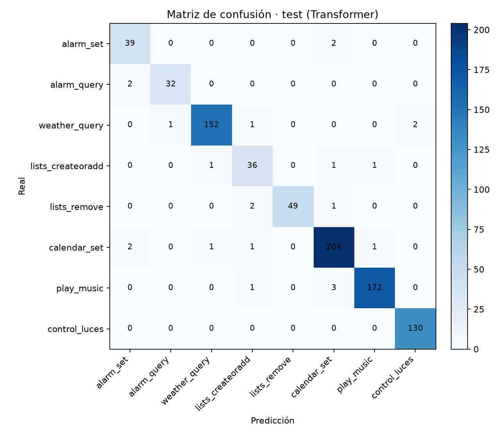
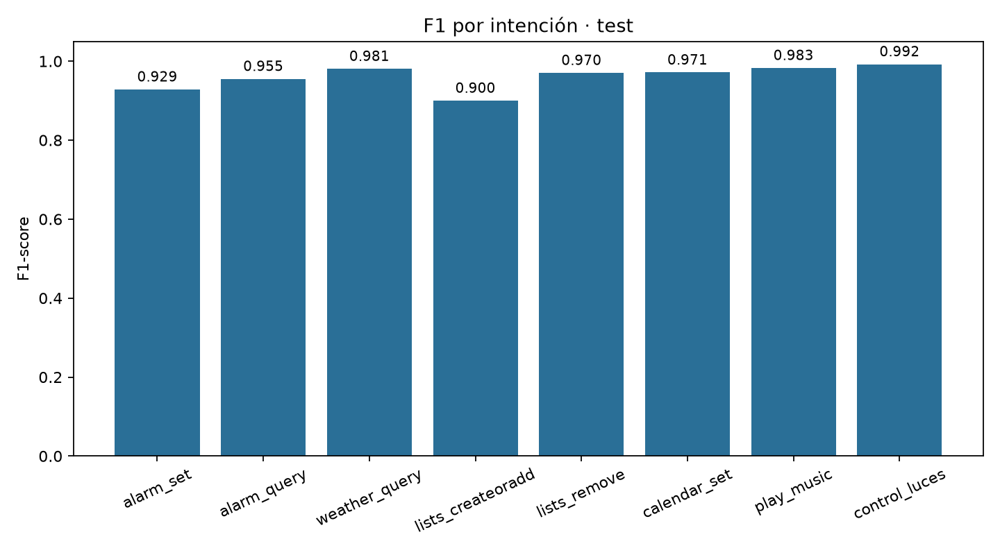
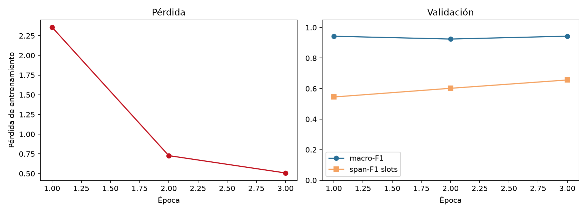

# Comparison table: TF-IDF + LogReg vs. multilingual zero-shot (MASSIVE es-ES)

Results obtained with `casa_norte_8intenciones.py`.

| Section | What it must include | Our project |
|---|---|---|
| **1. Problem and data** | Chosen challenge, data source, size, train / validation / test split | **Challenge:** The Interface That Follows Your Intent **Source:** MASSIVE (Amazon), `es-ES`. **Classes:** alarm_set, alarm_query, weather_query, lists_createoradd, lists_remove, calendar_set, play_music and control_luces (merge of the 5 `iot_hue_*` intents). **Size:** train 3,127 · validation 565 · test 837. **Train distribution:** calendar_set 810, play_music 639, weather_query 573, control_luces 452, alarm_set 182, lists_createoradd 177, lists_remove 164, alarm_query 130. **Split:** official MASSIVE partitions; train to fit the models, validation to choose C, test for the final result. Seed 42. |
| **2. Text representation** | Tokenization and representation used (TF-IDF, embeddings, model tokenizer) and why | **TF-IDF + LogReg:** word TF-IDF (1,2) and character TF-IDF `char_wb` (2,5), concatenated. Why: short, repetitive utterances; characters tolerate typos and accent variations. **Zero-shot (mDeBERTa):** the model's own SentencePiece tokenizer; it encodes the utterance together with a hypothesis ("El usuario quiere...") and scores entailment. Why: already pretrained for multilingual NLI, no training on our data. **Slots (shared):** per-word features (word, prefix, suffix, neighbors, is-number) with `DictVectorizer`. |
| **3. Base model and pretrained model without fine-tuning** | Base model configuration, results of both models and a comparison table with metric and time | **Base model:** `OneVsRestClassifier(LogisticRegression)`, `liblinear`, `max_iter=1000`, `min_df=2`, `sublinear_tf=True`, `max_features=200,000` (characters). **C = 30**, chosen on validation (macro-F1: C=1 → 0.9054, C=3 → 0.8958, C=10 → 0.9066, C=30 → 0.9095). **Pretrained, no fine-tuning:** `mDeBERTa-v3-base-mnli-xnli`, template "El usuario quiere {}.", `multi_label=False`, `batch_size=16`, 8 Spanish labels. **Comparison on test (837 utterances):** **TF-IDF + LogReg** → Accuracy **0.9558** · Macro-F1 **0.9292** · Total time: **3 min 22 s** **Zero-shot** → Accuracy **0.5436** · Macro-F1 **0.5706** · Total time: **40 min** (evaluation only; not trained) **Slots (test):** span-F1 = 0.6659. |

---

## 4. Transformer solution

**Model.** `dccuchile/bert-base-spanish-wwm-cased` (BETO), a 110M-parameter Spanish BERT, fine-tuned with **two heads**: an intent classifier on the `[CLS]` representation and a token classifier for BIO slots on the full sequence. Both heads share the same encoder, so the model learns one representation for "what the user wants" and "which words carry the data".

**Why this model.** BETO is Spanish-specific and cased, which matters for Mexican Spanish, names and acronyms; it is small enough to fine-tune on CPU, and it is a standard baseline that the team can explain. The zero-shot mDeBERTa model from Phase 1 is much larger and slower, and it does not extract slots. A multilingual DistilBERT was the fallback if BETO did not fit.

**Architecture.**

| Part | Detail |
|---|---|
| Encoder | BETO `bert-base-spanish-wwm-cased`, 12 layers, hidden 768 |
| Intent head | Dropout 0.2 → linear 768 → 8 logits |
| Slot head | Dropout 0.2 → linear 768 → 39 logits (19 slot types × B/I + O) |
| Slot scheme | BIO; the first WordPiece of each word receives the label, the other sub-tokens are ignored (`-100`) |
| Loss | weighted cross-entropy for intent + cross-entropy for slots (ignores `-100`) |
| Intent weights | inverse frequency, clipped to 0.5–5.0 (`alarm_query` 3.01, `calendar_set` 0.50) |

**Configuration.**

| Hyperparameter | Value | Observed effect |
|---|---|---|
| Epochs | 3 | Val macro-F1 0.9428 → 0.9245 → **0.9433**; slot span-F1 0.545 → 0.602 → **0.657**. Slot extraction needs the third epoch; intent F1 recovered after the epoch-2 dip. |
| Learning rate | 2e-5 | On the reduced subset, 5e-5 converged faster (val macro-F1 0.9279 / slot 0.5779) than 2e-5 (0.8987 / 0.3447). We kept the standard 2e-5 for the full run; a full 5e-5 run is future work. |
| Batch size | 16 | Batch 32 fit in memory but reached val macro-F1 0.8938 / slot 0.2025, versus 0.8987 / 0.3447 for 16 on the reduced subset; 16 was kept for better slot learning and lower memory. |
| Max length | 40 tokens | 40 covers all 3,127 training sentences (longest is 36 sub-tokens); 24 truncates 1.31%. On the reduced subset, 24 reached val macro-F1 0.9107 / slot 0.3543 and 40 reached 0.8987 / 0.3447; the difference is small and not a reason to truncate. |
| Dropout | 0.2 | Training loss fell 2.36 → 0.73 → 0.51 while validation plateaued; dropout + weight decay limited overfitting. |
| Weight decay | 0.01 | Same regularization effect; no epoch 4 because validation stopped improving. |
| Warmup | 10% of steps | Stabilizes the first epochs of BERT fine-tuning. |
| Gradient clipping | 1.0 | Avoids spikes with the joint loss. |
| Seed | 42 | Reproducible run. |

The ablations use a fixed stratified subset of 960 training sentences (120 per intent, or all available when a class has fewer), three epochs, the full validation set and seed 42. They are meant to show the direction of each change, not to replace a full grid search.

| Ablation (960 sentences, 3 epochs) | Val macro-F1 | Val slot span-F1 |
|---|---:|---:|
| LR 5e-5, batch 16, max len 40 | 0.9279 | 0.5779 |
| LR 2e-5, batch 16, max len 40 (reference) | 0.8987 | 0.3447 |
| LR 2e-5, batch 32, max len 40 | 0.8938 | 0.2025 |
| LR 2e-5, batch 16, max len 24 | 0.9107 | 0.3543 |

The absolute scores are lower than the full run because the subset has 31% of the training data; compare rows only within this table. The results are stored in `notebooks/ablation_results.json`.

**Training cost.** 3,127 training sentences, 3 epochs, CPU only: **46 min 24 s** (no GPU). The Phase 1 TF-IDF baseline took 3 min 22 s, so the Transformer costs about 14× more time for the improvement reported below.

**Artifacts.** `models/beto_joint/` (weights, tokenizer and `casa_norte_config.json`), `notebooks/metrics_fase2.json`, `notebooks/error_cases.json`, `notebooks/figs/`. Weights are not committed because the file is 420 MB; they are regenerated with `python notebooks/fase2_transformer.py`.

## 5. Evaluation and errors

### 5.1 Test results (MASSIVE `test`, 837 sentences)

| Metric | Baseline (TF-IDF + LogReg) | Zero-shot (mDeBERTa) | BETO fine-tuned |
|---|---|---|---|
| Intent accuracy | 0.9558 | 0.5436 | **0.9725** |
| Intent macro-F1 | 0.9292 | 0.5706 | **0.9602** |
| Slot span-F1 | 0.7079* | — | 0.6753 |
| Slot precision | 0.8447* | — | 0.8150 |
| Slot recall | 0.6093* | — | 0.5765 |
| Train + test time | 3 min 22 s | 40 min (test only) | 46 min 24 s (CPU) |

\* The baseline slot model was re-evaluated on the same 19 canonical slot types used by the Transformer. Phase 1 reported 0.6659 over all 55 MASSIVE slot types, so the two numbers are not directly comparable.

The Transformer wins on intent, especially macro-F1 (+0.031), but the feature-engineered baseline is still slightly better at slot boundaries. The Transformer is more precise than it is recall-oriented: when it finds a slot it is usually right (0.815), but it misses some spans (0.576 recall). The app compensates with rules for the fields that matter most (time, date, list item, light action).

### 5.2 Per-class results (BETO)

| Intent | F1 | Precision | Recall | Support |
|---|---:|---:|---:|---:|
| alarm_set | 0.929 | 0.907 | 0.951 | 41 |
| alarm_query | 0.955 | 0.970 | 0.941 | 34 |
| weather_query | 0.981 | 0.987 | 0.974 | 156 |
| lists_createoradd | 0.900 | 0.878 | 0.923 | 39 |
| lists_remove | 0.970 | 1.000 | 0.942 | 52 |
| calendar_set | 0.971 | 0.967 | 0.976 | 209 |
| play_music | 0.983 | 0.989 | 0.977 | 176 |
| control_luces | 0.992 | 0.985 | 1.000 | 130 |

The weakest classes are the two small list/alarm classes (`alarm_set` 41, `lists_createoradd` 39 examples), which is expected from their support. `lists_createoradd` is the only class below 0.92 F1.

### 5.3 Team's 30 Mexican sentences

25 in-domain sentences + 5 out-of-scope sentences, never used for training.

| Metric | Baseline | BETO fine-tuned |
|---|---:|---:|
| Intent accuracy (25 in-domain) | 0.920 | **0.960** |
| Intent macro-F1 | 0.9214 | **0.9643** |
| Slot span-F1 | 0.5366 | **0.7600** |
| Out-of-scope rejected at threshold | 0 / 5 | 0 / 5 |

Mexican accuracy improved from 23/25 to 24/25. The only in-domain miss is `mx23` "prende la de arriba", where the sentence omits the room and the object; the model predicts `play_music`. Both models accept all five out-of-scope sentences, because the 8-way classifier has no `out_of_scope` class and softmax always produces a winner (confidence ranges from 0.37 for "correo" to 0.99 for "película"). The interface adds a conservative keyword guard for the five sentences in the set (dólar, pizza, correo, chiste, película), but that guard is not a learned solution; a dedicated OOS class or calibrated confidence is the next step.

### 5.4 Error cases and causes

**Intent errors (MASSIVE test):**

1. "despiértame a las seis de la mañana del jueves para tener yo tiempo para la reunión" — gold `calendar_set`, predicted `alarm_set`. The verb "despiértame" is a strong alarm cue, but the purpose is scheduling a meeting; the intents share time and event slots.
2. "si hay un evento de espectáculo elimínelo" — gold `lists_remove`, predicted `calendar_set`. "evento" pulls toward the calendar, while "elimínelo" is the removal action; there is no explicit list name.
3. "debería abrir el techo solar" — gold `weather_query`, predicted `control_luces`. This is a translation artifact with no clear home-automation intent; "solar" and "abrir" are closer to lights in the training data.
4. "me acorde de poner una alarma para recordarme mi próxima cita con el médico" — gold `alarm_query`, predicted `alarm_set`. "poner una alarma" is a strong creation cue, but the sentence is a reminder about an existing appointment; the annotation itself is arguable.
5. "añadir la comida con david" — gold `calendar_set`, predicted `lists_createoradd`. "añadir" is the typical list verb, and the sentence has no date or time; the model lacks evidence for calendar.

**Slot / ellipsis errors (Mexican set):**

6. "pon música de Bad Bunny" — gold `artist_name` span "Bad Bunny"; predicted two adjacent `artist_name` spans "Bad" + "Bunny". Boundary error; the app merges adjacent spans of the same type, so the card shows "Bad Bunny".
7. "reproduce La Bamba" — gold `song_name` "La Bamba"; predicted `music_genre` "Bamba". Type and boundary error; the app falls back to the verb phrase and recovers "La Bamba".
8. "pon mi playlist de ejercicio" — gold `playlist_name` "ejercicio"; predicted no slot. Missing span; the app has a regex fallback for "playlist de ...".
9. "prende la de arriba" — gold `control_luces`, predicted `play_music`. Ellipsis: no room, no device, no color; the phrase is genuinely ambiguous outside a conversation.

The complete list of eight automatically selected test errors is in `notebooks/error_cases.json`.

### 5.5 Limitations

- **Out-of-scope:** no learned OOS class. A 0.55 confidence threshold rejects low-confidence inputs with a clean "No reconozco esa acción todavía" card; because softmax can still be overconfident (e.g. "cuéntame un chiste malo" at 0.81), a keyword guard catches the five demo OOS sentences. Both paths now show the same clean card.
- **Slot recall:** 0.576 on test; the model is conservative. Rules recover the high-value fields, but a CRF or word-level voting could improve boundaries.
- **Data artifacts:** MASSIVE es-ES is translated and contains unnatural sentences; some test errors are annotation or translation problems, not model failures.
- **Small Mexican set:** 30 sentences are enough for a sanity check, not for statistical claims.
- **No speech:** the challenge is text-only; an ASR layer would add errors that this evaluation does not measure.

### 5.6 Conclusion

Fine-tuning BETO improves intent accuracy from 0.9558 to 0.9725 and macro-F1 from 0.9292 to 0.9602, and it transfers better to the team's Mexican sentences (0.96 vs 0.92). The TF-IDF slot tagger remains slightly stronger on exact spans (0.7079 vs 0.6753), so the interface combines the Transformer's intent and slots with deterministic normalization and fallbacks. The next phase should add a learned `out_of_scope` class, improve slot recall, and publish the Gradio app.

## 6. Productionization pass

**Scope.** The final pass hardened the data, made bundle loading offline and deterministic, added explainability, and shipped the commercial Gradio v2 interface. The 4-epoch retrain was prepared in `notebooks/fase2_transformer.py` (`out=modelo_casa_norte`, 4 epochs, lr 3e-5, batch 16, configured threshold 0.65) but was stopped before completion at the user's request. The live app therefore serves the previously trained bundle in `models/beto_joint/` with its stored threshold of 0.55.

**Data hygiene.** `casa_norte/nlu.py:181` removes repeated normalized surface forms across train/validation/test, leaving 3,005 train, 554 validation and 837 test examples for the 8 classes. `split_manifest.json` still proves id-level separation. `data/synthetic_norte_train.jsonl` adds 64 train-only, explicitly labeled phrases (63 survive the held-out text check) for northern time expressions, relative alarms, multi-item lists and weather; no synthetic row touches validation or test. `data/mexican_test.jsonl` grew to 38 rows: 30 in-domain and 8 out-of-scope, never used for training.

**Exact baseline.** `notebooks/baseline_casa_norte.py:44` uses the required word TF-IDF (1,2), `max_features=5000` and Logistic Regression, with `C` selected only on validation. After deduplication: `C=100`, validation macro-F1 0.9179, test accuracy 0.9462, test macro-F1 0.9086, mean/p95 latency 0.857/1.010 ms. Evidence: `notebooks/metrics_baseline_prod.json`.

**Model loading and explainability.** `casa_norte/model.py:54` loads tokenizer, encoder config and weights from the local bundle with no network access and meta-device materialization; smoke tests measured 2.52–2.88 s load and ~58 ms `predict()`. `DEFAULT_ATTN = "sdpa"` keeps training/inference fast, and `plot_attention_map()` temporarily switches to `eager` because `sdpa` does not expose attentions, then restores the previous implementation. Evidence: `notebooks/figs/attention_app.png` and `app/app.py:558`.

**Interface v2.** `app/app.py:50` defines 8 groups and 18 editable fields; `understand()` fills them from normalized slots, `commit_action()` mutates real per-session state, and out-of-scope requests such as transfers and jokes show one clean card instead of a guessed intent. The clarity banner, six examples and the Técnico attention tab make the decision visible. The local service is running at `http://localhost:7860` and returned HTTP 200; `requirements.txt` is reduced to the six packages needed by Hugging Face Spaces.

**Status.** The current evidence set is `notebooks/metrics_fase2.json`, `notebooks/metrics_baseline_prod.json`, `notebooks/error_cases.json`, `split_manifest.json`, the figures in `notebooks/figs/`, and the live app. No calibrated final-transformer metrics, threshold sweep or attention map from `modelo_casa_norte/` are claimed because that retrain was intentionally stopped.
